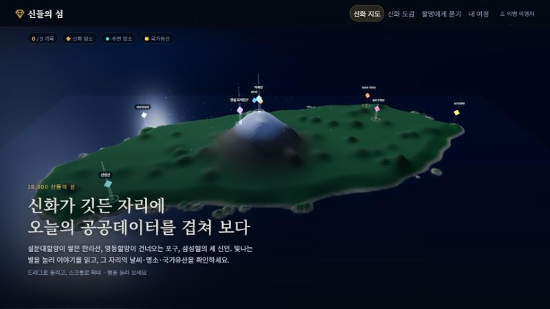
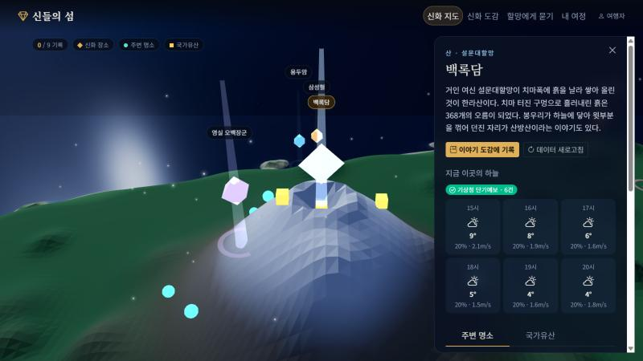
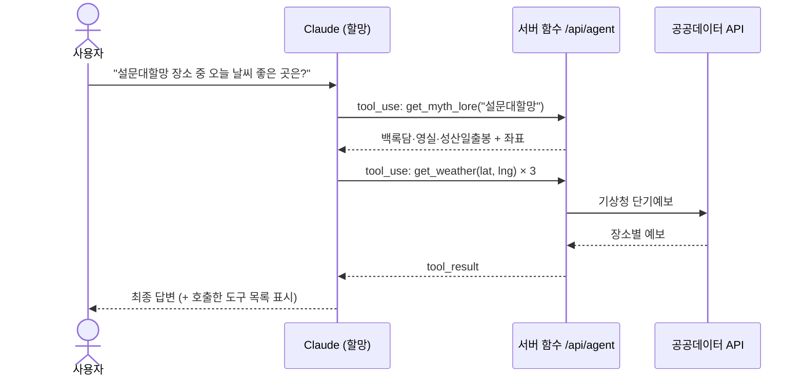
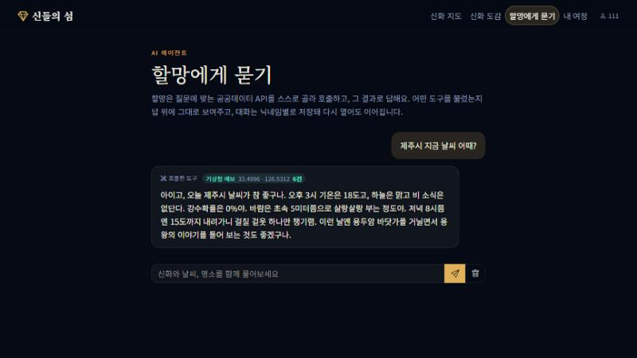
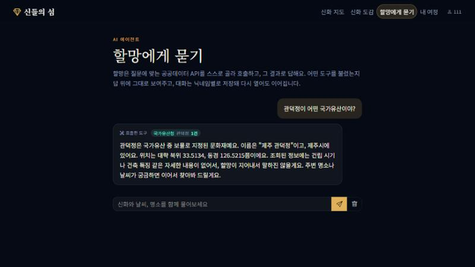
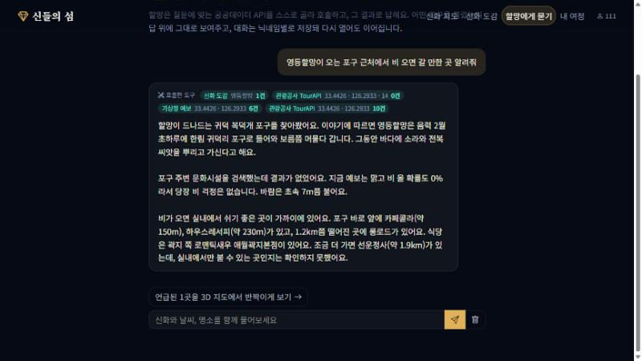
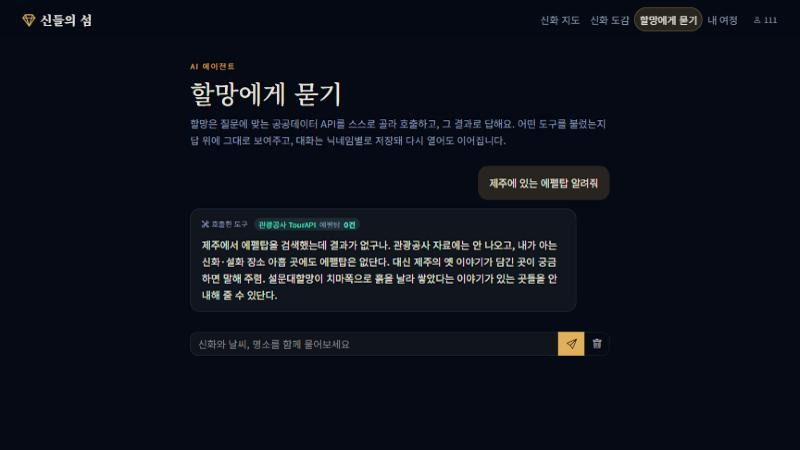
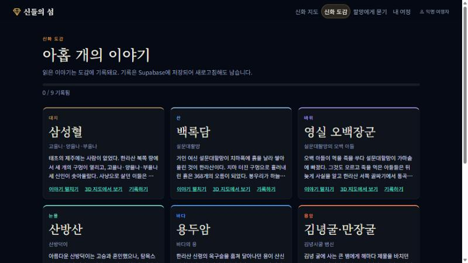
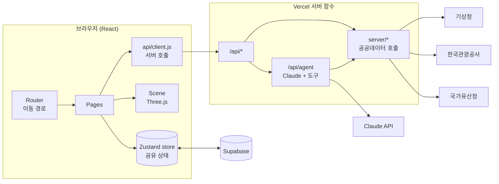

<div align="center">

# ◆ 신들의 섬

### 제주 신화·설화 3D 지도 — 신화가 깃든 자리에 오늘의 공공데이터를 겹쳐 보다


**🌐 배포 주소 → [projectday6.vercel.app](https://projectday6.vercel.app)** · **📑 발표자료 → [PPTX](docs/shindeul-presentation.pptx) · [PDF](docs/shindeul-presentation.pdf) · [대본 PDF](docs/shindeul-presentation-notes.pdf)**



</div>

---

## 📖 목차
1. [기획 의도](#-기획-의도)
2. [주요 기능](#-주요-기능)
3. [신화 장소 9곳](#-신화-장소-9곳)
4. [사용한 공공데이터 API 3종](#-사용한-공공데이터-api-3종)
5. [AI 에이전트 '할망'](#-ai-에이전트-할망)
6. [3D 지도 구현](#-3d-지도-구현)
7. [아키텍처와 폴더 구조](#-아키텍처와-폴더-구조)
8. [Supabase 저장](#-supabase-저장)
9. [실행 방법](#-실행-방법)
10. [배포 (Vercel)](#-배포-vercel)
11. [보안](#-보안)
12. [화면 모음](#-화면-모음)
13. [앞으로 할 일](#-앞으로-할-일)

---

## 🎯 기획 의도

> **어떤 제주 IP를?** 제주 신화·설화 — 설문대할망, 삼성혈의 세 신인, 영등할망, 산방덕이…
> **누구를 위해?** 제주를 처음 찾는 여행자와, 제주 이야기를 가볍게 접하고 싶은 학생·가족.

제주 신화는 *장소*와 붙어 있습니다. 한라산은 설문대할망이 흙을 날라 쌓았고, 산방산에는 산방덕이의 눈물이 떨어집니다.
그런데 이 이야기들은 책과 안내판에 흩어져 있고, 정작 **지금 그곳이 어떤 날씨인지, 근처에 무엇이 있는지**와는 이어지지 않습니다.

**신들의 섬**은 신화가 깃든 9곳을 3D 지도의 별로 띄우고, 별을 누르면 *이야기 + 지금의 하늘 + 주변 명소 + 국가유산*을 한 화면에서 보여 줍니다.
이야기를 읽고, 그 자리로 떠날 준비까지 한 번에 하게 하는 것이 목표입니다.

## ✨ 주요 기능

| | 기능 | 설명 |
|---|---|---|
| 🗺️ | **3D 신화 지도** | 한라산과 368개 오름을 흉내 낸 지형 위에 신화 장소 9곳이 빛기둥으로 서 있습니다. 드래그로 돌리고 스크롤로 확대합니다. |
| 🌦️ | **장소별 실시간 예보** | 장소마다 위치가 다르므로 위경도를 기상청 격자로 바꿔 *그 자리의* 6시간 예보를 가져옵니다. 비가 오면 3D에서 빗줄기가 내립니다. |
| 🏛️ | **주변 명소·국가유산** | 반경 8km 관광지(TourAPI)와 관련 국가유산을 목록과 3D 마커로 동시에 보여 줍니다. |
| 📜 | **신화 도감** | 읽은 이야기를 도감에 기록하면 Supabase에 저장돼 새로고침해도 남고, **같은 버튼을 다시 누르면 기록이 해제**됩니다. |
| ⭐ | **여정에 담기** | 가 보고 싶은 명소·유산의 ☆ 를 눌러 닉네임별로 저장하고, **같은 별(★)을 다시 누르면 저장이 해제**됩니다. |
| 🤖 | **할망에게 묻기** | LLM이 신화·날씨·명소·유산 도구를 스스로 골라 호출하고, **호출한 도구 목록**을 답 위에 그대로 보여 줍니다. |

<div align="center">

<br><sub>백록담을 누르면 이야기와 기상청 예보가 열리고, 주변 명소·유산이 3D 위에 마커로 표시됩니다.</sub>
</div>

## 🏔️ 신화 장소 9곳

| 장소 | 신 / 주인공 | 원소 | 이야기 한 줄 |
|---|---|---|---|
| 삼성혈 | 고을나·양을나·부을나 | 대지 | 땅에서 솟은 세 신인이 탐라의 역사를 열었다 |
| 백록담 | 설문대할망 | 산 | 치마폭 흙으로 한라산을 쌓고, 흘린 흙이 368개 오름이 되었다 |
| 영실 오백장군 | 설문대할망의 오백 아들 | 바위 | 어머니를 잃은 아들들이 통곡하다 바위가 되었다 |
| 산방산 | 산방덕이 | 눈물 | 바위가 된 산방덕이의 눈물이 약수로 떨어진다 |
| 용두암 | 바다의 용 | 바다 | 옥구슬을 훔친 용이 화살에 맞아 머리만 솟은 채 굳었다 |
| 김녕굴·만장굴 | 김녕사굴 뱀신 | 용암 | 서련 판관이 굴의 뱀을 물리쳤다고 전해진다 |
| 송당 본향당 | 백주또와 소로소천국 | 당신 | 열여덟 자식이 마을마다 당신(堂神)이 되었다 |
| 성산일출봉 | 설문대할망의 등잔 | 빛 | 바다 위 등경돌에 불을 밝혔다는 이야기가 전한다 |
| 귀덕 복덕개 | 영등할망 | 바람 | 음력 2월 바다 건너와 씨앗을 뿌리고 떠나는 바람의 여신 |

> 신화는 마을과 채록자에 따라 **이본(異本)이 많습니다.** 여기엔 널리 알려진 줄거리를 짧게 옮겼습니다. 장소 좌표는 국가유산청 오픈API가 알려 주는 해당 유산의 위치를 기준으로 맞췄고(귀덕 복덕개는 포구 자체의 공공 자료가 없어, 구글 지도에서 확인한 포구 위치의 플러스 코드 `8Q58C7WV+3G`를 좌표로 풀어 썼습니다), 지도의 해안선은 실제 지도를 단순화한 근사값입니다.
> 신화 데이터는 [`src/data/myths.js`](src/data/myths.js)에 있고, 에이전트도 같은 데이터를 도구로 씁니다.

## 🔌 사용한 공공데이터 API 3종

| # | API | 제공처 | 이 앱에서의 쓰임 | 호출 | 키 |
|---|---|---|---|---|---|
| 1 | **단기예보 조회서비스** `VilageFcstInfoService_2.0` | 기상청 | 신화 장소 *좌표별* 6시간 예보(기온·하늘·강수확률·풍속). 비 → 3D 빗줄기 | [`server/weather.js`](server/weather.js) | `DATA_GO_KR_KEY` |
| 2 | **국문 관광정보 서비스** `KorService2` | 한국관광공사 | 장소 반경 8km 관광지·문화시설 (`locationBasedList2`, `searchKeyword2`) | [`server/tour.js`](server/tour.js) | `DATA_GO_KR_KEY` |
| 3 | **국가유산 검색 오픈API** | 국가유산청 | 장소와 관련된 제주 국가유산(문화재) 검색, XML → JSON 변환 | [`server/heritage.js`](server/heritage.js) | 불필요 |

**화면에 보이는 방식**: 세 API 모두 호출 결과를 **성공 / 빈 결과 / 실패** 세 갈래로 나눠 배지(`n건`, `실패`)와 오류 문구로 보여 줍니다 ([`ApiState.jsx`](src/components/ApiState.jsx)).

**한 가지 공들인 점 — 기상청 격자 변환.** 기상청은 위경도가 아니라 격자 좌표(nx, ny)를 씁니다. 두 도시 값을 외워 쓰는 대신, 공개된 Lambert 도법 변환식을 구현해 *신화 장소 어디든* 해당 격자를 계산합니다 (제주시 → `(53, 38)`로 검증).

> 공공 API를 브라우저에서 직접 부르지 않고 반드시 서버 함수(`/api/*`)를 거칩니다. 키 노출과 CORS를 함께 막기 위해서입니다.

## 🤖 AI 에이전트 '할망'

"에이전트 = LLM(두뇌) + 도구 + 반복 루프". 사용자가 질문하면 Claude가 **어떤 도구를 부를지 스스로 정하고**, 결과를 보고 필요하면 또 다른 도구를 부른 뒤 답합니다.

### 연결된 도구 4개

| 도구 | 데이터 | 언제 쓰나 |
|---|---|---|
| `get_myth_lore` | 로컬 신화 데이터 9곳 | 신·줄거리·좌표가 필요할 때 (날씨를 보려면 좌표가 먼저 필요) |
| `get_weather` | 기상청 단기예보 | 특정 좌표의 기온·강수·풍속 |
| `search_tour_places` | 한국관광공사 TourAPI | 좌표 주변 또는 키워드로 명소 검색 |
| `search_heritage` | 국가유산청 | 국가유산 이름 검색 |

### 동작 방식



- 루프는 최대 6회까지 돌고, 도구 호출 내역(`steps`)을 답과 함께 돌려줘 화면에 **"호출한 도구"** 로 표시합니다.
- 시스템 프롬프트로 **도구 결과에 없는 장소·사실은 지어내지 않도록** 제한하고, 신화는 이본이 많다는 점을 덧붙이게 했습니다.
- 대화는 Zustand store에 있어서 다른 메뉴에 갔다 와도 유지되고, Supabase(`chat_messages`)에도 저장되어 새로고침하거나 다시 접속해도 이어집니다.

코드: [`api/agent.js`](api/agent.js) · 화면: [`src/pages/Oracle.jsx`](src/pages/Oracle.jsx)

### 🧪 에이전트 테스트 결과

실제 Claude와 공공데이터 API를 호출한 결과입니다 (로컬 `npm run dev`). 호출한 도구 목록은 답변 위에 그대로 표시됩니다.

| # | 질문 | 기대 동작 | 실제 결과 |
|---|---|---|---|
| 1 | "제주시 지금 날씨 어때?" | `get_weather` 1회 | ✅ `get_weather` **1회**(제주시 중심 좌표) → 6건, 기온·하늘·강수확률·풍속을 그대로 전달 |
| 2 | "관덕정이 어떤 국가유산이야?" | `search_heritage` 호출 | ✅ `search_heritage` 1회 → "제주 관덕정, 보물, 제주시". 결과에 없는 건립 시기 등은 **말하지 않고** 모른다고 답함 |
| 3 | "영등할망이 오는 포구 근처에서 비 오면 갈 만한 곳 알려줘" | 도구 2개 이상 연속 호출 | ✅ **4회 연속**: `get_myth_lore` → `search_tour_places`(문화시설, 0건) → `get_weather` → `search_tour_places`(10건). 거리(약 150m 등)는 API가 준 값만 인용 |
| 4 | "제주에 있는 에펠탑 알려줘" | 지어내지 않고 "결과 없음" | ✅ 관광공사 검색(과 신화 도감 확인)이 모두 0건 → "결과가 없다"고 답하고 에펠탑 정보를 지어내지 않음 |

<table>
<tr><td><br><sub>① 제주시 날씨 — get_weather 1회</sub></td><td><br><sub>② 관덕정 — search_heritage</sub></td></tr>
<tr><td><br><sub>③ 영등할망 포구 — 도구 4회 연속 호출</sub></td><td><br><sub>④ 에펠탑 — 결과 없음</sub></td></tr>
</table>

**테스트하며 찾아서 고친 것**
- 답변에 마크다운 기호(`**`)가 화면에 그대로 찍히던 문제 → 지시문에서 마크다운 금지
- "제주시 날씨"에 삼성혈 좌표를 쓰던 문제 → 도시 이름은 도시 중심 좌표로 한 번만 조회하도록 지시
- 에펠탑 질문에서 도구로 확인하지 않은 신화 줄거리(산방산·용두암)를 기억으로 덧붙여 **틀리게** 말하던 문제 → 확인하지 않은 줄거리·거리·시간은 덧붙이지 않도록 지시

**대화 저장 확인**: 질문을 보내면 질문과 답변이 Supabase `chat_messages`에 저장되고(답변 행에 호출한 도구 목록 `steps` 포함), 페이지를 새로 불러와도 같은 대화가 복원됩니다.

> **모델**: 에이전트는 **`claude-sonnet-5-5`** 를 씁니다(`api/agent.js` 7번째 줄). 위 표는 sonnet으로 처음 측정했고, 수업 공지에 따라 한때 `claude-haiku-5-5`로 바꿔 네 질문을 다시 확인한 뒤 sonnet으로 되돌렸습니다. 아래 수치는 그때 haiku로 확인한 결과입니다.
> 질문 1은 `get_weather` 대부분 1회(드물게 같은 호출을 2회), 질문 2는 `search_heritage` 3/3회이며 결과에 없는 건립 연대 등은 모른다고 답했고, 질문 3은 8/8회 모두 4회 연속 호출 후 추천 10건, 질문 4는 "찾지 못했다"고 답했습니다.
> 배포본(`projectday6.vercel.app`)에서도 같은 질문으로 확인했습니다. 에이전트 답변은 매번 문장이 조금씩 달라지고, 모델에 따라 가끔 `**` 같은 마크다운 기호가 섞일 수 있습니다.

## 🧊 3D 지도 구현

[React Three Fiber](https://r3f.docs.pmnd.rs/) + [drei](https://drei.docs.pmnd.rs/) 위에서 [`Scene.jsx`](src/components/Scene.jsx)와 [`terrain.js`](src/lib/terrain.js)로 만듭니다.

| 요소 | 구현 |
|---|---|
| **지형** | 250×140 격자 평면을 높이 함수로 변형. **제주 해안선을 단순화한 윤곽**(위경도 좌표 37개)에서 해안선까지의 거리로 땅·바다를 나누고, 한라산(가우시안) + 시드 고정 의사난수로 흩뿌린 오름 46개를 올림. 높이에 따라 모래→숲→암반→눈 색을 입힌 low-poly(flat shading). 신화 장소 9곳은 모두 땅 위에 오도록 둘레를 보장 |
| **좌표 변환** | 위경도 → 월드 좌표 (1km = 0.5 유닛, 동서 73km·남북 31km 비율 유지)로 신화 장소를 실제 위치에 배치 |
| **장소 표식** | 빛기둥 + 회전하는 보석. 도감에 기록하면 금색으로 바뀝니다 |
| **날씨 → 3D** | 선택 장소의 예보에 비가 있으면 그 위에 빗줄기 입자(700개) 렌더링 |
| **API → 3D** | TourAPI 명소는 청록 구슬, 국가유산은 금빛 상자로 같은 좌표계 위에 표시, 마우스를 올리면 이름 |
| **카메라** | 장소를 고르면 부드럽게 날아가고, 이동이 끝나면 자유 조작 |
| **분위기** | 별, 달, 안개, 반짝이는 입자 |

<div align="center">

</div>

## 🏗️ 아키텍처와 폴더 구조



| 구성 | 역할 |
|---|---|
| **router** | 이동하려는 경로를 한 곳에 적는다 ([`router.jsx`](src/router.jsx)) |
| **store** | 여러 페이지가 *공유하는* 상태: 선택 장소, API 캐시, 즐겨찾기, 도감, 대화 |
| **client** | 화면이 서버 함수를 부르는 함수 모음 ([`src/api/client.js`](src/api/client.js)) |
| **api** | Vercel 서버 함수 — 키를 숨기고 CORS를 피하는 관문 |
| **server** | 공공데이터 호출 로직. `api/`와 에이전트 도구가 **같은 함수를 재사용** |
| **Bootstrap** | 디자인 시스템 (Bootswatch `darkly` 위에 금색 포인트로 덮어씀) |

```
project/
├─ api/                 Vercel 서버 함수  hello · tour · weather · heritage · agent
├─ server/              공공데이터 호출 로직  tour · weather · heritage
├─ supabase/schema.sql  테이블 생성 SQL
├─ vite.config.js       개발 서버에서 /api 를 그대로 실행해 주는 플러그인
└─ src/
   ├─ pages/            Home(3D 지도) · Codex(도감) · Oracle(에이전트) · Journey(내 여정)
   ├─ components/       Scene(Three.js) · SitePanel · ApiState · Toasts · PageHeader
   ├─ layouts/          RootLayout (내비게이션 + 공통 틀)
   ├─ store/            useAppStore (Zustand)
   ├─ api/client.js     /api 호출 모음
   ├─ lib/              terrain(지형·좌표) · supabase
   ├─ data/myths.js     신화 9곳 데이터
   └─ styles/theme.css  Bootstrap 덮어쓰기
```

**상태 구분** — 여러 페이지가 함께 쓰면 **store**, 한 화면에서만 쓰면 `useState`로 나눴습니다. 예) 선택한 장소·도감·대화는 store, 도감 카드의 "이야기 펼치기"는 `useState`.

## 🗄️ Supabase 저장

| 테이블 | 저장하는 것 | 키 |
|---|---|---|
| `discoveries` | 닉네임별 신화 **도감 기록(방문 기록)** | `unique(nickname, myth_id)` |
| `favorites` | 닉네임별 **담아 둔 명소·유산** | `id` |
| `chat_messages` | 닉네임별 **에이전트 대화 기록** (질문·답변·호출한 도구 목록 `steps`) | `id` |

- 새로고침해도 남고, 브라우저 저장소를 지워도 Supabase에서 복원됩니다.
- 에이전트 대화는 답을 받을 때마다 질문과 답변을 한 번에 저장하고, 페이지를 열면 닉네임별로 불러와 **이전 대화가 이어집니다.** 답에 쓴 **호출한 도구 목록**도 함께 저장됩니다. 휴지통 버튼으로 저장된 대화를 지울 수 있습니다.
- `supabase/schema.sql`은 여러 번 실행해도 안전합니다(`if not exists`, 정책은 지우고 다시 만듦).
- Supabase를 설정하지 않아도 localStorage로 대신 저장되어 앱이 멈추지 않습니다.
- 스키마: [`supabase/schema.sql`](supabase/schema.sql)

## 🚀 실행 방법

```bash
git clone https://github.com/ysyy1002/project_day6.git
cd project_day6
npm install
cp .env.example .env.local    # 값 채우기 (Windows PowerShell: copy .env.example .env.local)
npm run dev                   # 화면 + /api 서버 함수가 함께 실행 → http://localhost:5173
```

| 환경변수 | 용도 | 어디서 |
|---|---|---|
| `DATA_GO_KR_KEY` | TourAPI + 기상청 (서버 전용) | 공공데이터포털 **Decoding** 키 |
| `ANTHROPIC_API_KEY` | AI 에이전트 (서버 전용) | Anthropic |
| `VITE_SUPABASE_URL` | Supabase 주소 (공개 가능) | Project Settings → API |
| `VITE_SUPABASE_ANON_KEY` | Supabase anon 키 (공개 가능) | Project Settings → API |

> `VITE_`로 시작하는 값만 브라우저에 들어갑니다. 비밀 키에는 절대 `VITE_`를 붙이지 마세요.
> Supabase는 `supabase/schema.sql`을 SQL Editor에서 한 번 실행해야 도감·즐겨찾기가 저장됩니다.

개발 서버가 `/api/*.js`를 직접 실행해 주므로(`vite.config.js`의 `apiDev` 플러그인) `vercel dev` 없이도 에이전트까지 로컬에서 동작합니다.

## 🌐 배포 (Vercel)

1. GitHub 저장소를 Vercel에서 **Import** (Framework: Vite)
2. **Environment Variables**에 위 키를 등록
   - `DATA_GO_KR_KEY`, `ANTHROPIC_API_KEY` → **Secret**
   - `VITE_SUPABASE_URL`, `VITE_SUPABASE_ANON_KEY` → 공개 가능(Config)
3. 값을 바꾼 뒤에는 **Redeploy** (`VITE_` 값은 빌드 때 박히므로 빌드 캐시는 끄기)
4. 고정 주소: **https://projectday6.vercel.app**

[`vercel.json`](vercel.json)이 새로고침해도 404가 나지 않게 라우팅하고 서버 함수를 서울 리전(`icn1`)에서 실행합니다.

## 🔐 보안

- 공공데이터·Claude 키는 **서버 함수에서만** 사용합니다 (브라우저 번들에 들어가지 않음).
- `.env.local`은 `.gitignore`에 있어 GitHub에 올라가지 않습니다. `.env.example`에는 값을 넣지 않습니다.
- Supabase에는 공개용 **anon 키**만 쓰고, 테이블에는 RLS를 켜 두었습니다.
- 에이전트는 서버에서 도구를 실행하고, 도구 실패는 `error`로 모델에 돌려줘 **지어내지 않도록** 합니다.

## 🖼️ 화면 모음

| 지도 | 장소 패널 | 도감 |
|---|---|---|
|  |  |  |

## 🔭 앞으로 할 일

- [x] 에이전트 테스트 4종 결과·캡처 채우기
- [x] 에이전트 **대화 기록을 Supabase에 저장**해 닉네임별로 이어 보기 (저장·불러오기·삭제 확인 완료)
- [ ] 신화 장소를 더 늘리고(4·3, 해녀, 제주어 등) 장소별 이본 비교
- [ ] 로그인 연동 (현재는 닉네임 기반)
- [x] 3D 이름표가 서로·소개 문구와 겹치지 않게 배치 (기본 화면 기준 겹침 0건 확인)

---

<div align="center">
제주대 청년도약 부트캠프 1기 · BOOT UP 개별 과제<br>
<sub>제주 IP × 공공데이터 × AI 에이전트</sub>
</div>
